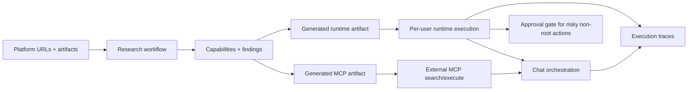

# MCPSurface

MCPSurface turns platform documentation into a governed execution surface for chat and MCP clients.

The core problem it solves is that modern platforms expose large, fast-changing API surfaces, but most AI integrations still depend on hand-written tools, brittle wrappers, or flat tool menus that do not scale well. MCPSurface researches official docs and specs, extracts real operations, synthesizes a capability surface, generates runtime and MCP artifacts from that surface, and then lets users drive real execution through chat or an external MCP endpoint with runtime isolation, approvals, and traces built in.

## What It Does

- ingests platform source URLs and uploaded artifacts
- researches docs, reference pages, and structured specs with a LangGraph workflow
- extracts explicit API operations and synthesizes canonical capabilities
- generates:
  - a runtime artifact for TypeScript execution
  - an MCP artifact for search and execute
- lets users interact through:
  - chat
  - direct runtime execution
  - external MCP clients
- enforces:
  - per-user runtimes
  - owner approval for risky non-root actions
  - execution tracing

## Architecture

The system is organized as a pnpm monorepo:

- `apps/web`
  - React + TanStack Router frontend
  - platform setup, research UI, chat UI, runtime UI, sharing, approvals, MCP token management
- `apps/server`
  - Fastify API
  - research workflow
  - artifact generation
  - runtime orchestration
  - approvals
  - sharing
  - external MCP endpoint
- `packages/shared`
  - cross-app domain models
  - contracts
  - zod schemas

## End-to-End Flow



## Research Flow

Research uses a LangGraph pipeline in `apps/server/src/modules/research/`:

1. `source_discovery_agent`
   - fetches platform-provided URLs and uploaded artifacts
   - discovers related reference/spec pages
2. `structured_parser_agent`
   - parses OpenAPI/Swagger deterministically when available
3. `docs_extraction_agent`
   - harvests explicit HTTP operations from docs pages
   - uses one bounded LLM extraction pass for supporting findings
4. `capability_synthesis_agent`
   - synthesizes canonical capabilities from operation-backed evidence only

Important design choice:

- `ResearchFinding` is evidence
- `Capability` is an executable action definition
- a capability is only created when there is a real operation behind it

That makes the output suitable for later TypeScript code generation and runtime execution, rather than just document summarization.

## Generated Artifacts

After research completes, the system generates two artifacts from the capability surface:

- `runtime`
  - a TypeScript runtime interface with typed capability inputs
  - used by runtime code execution and chat orchestration
- `mcp`
  - a compact MCP surface exposing `search` and `execute`
  - used by the external MCP endpoint

Artifact generation lives in `apps/server/src/modules/generation/`.

## Chat, Runtime, and Approvals

Chat is not just an LLM wrapper. It orchestrates:

- context retrieval over capabilities, findings, traces, and logs
- runtime lifecycle actions
- execution planning
- Worker/source rewrite flows
- approval-aware execution
- grounded final responses

Risk model:

- platform owner can execute anything
- non-root users can execute `read`
- non-root `write` and `destructive` actions create `ApprovalRequest` records
- approved work executes in the requester's runtime, never the owner's runtime

## External MCP Access

The platform can also be exposed through:

- `POST /mcp/:platformId`

with bearer-token auth via per-platform MCP access tokens.

External MCP requests reuse the same:

- capability surface
- per-user runtime resolution
- approval gate
- execution traces

There is no separate execution path for MCP.

## Persistence

The app currently uses a local SQLite database for app records plus filesystem artifact storage.

Current dev database:

- `DATA_DIR/DATABASE_PATH`
- default: `.data/mcpsurface.db`

Reset command:

```bash
pnpm reset-dev-db
```

## Development

Install dependencies:

```bash
pnpm install
```

Start the server:

```bash
pnpm dev:server
```

Start the web app:

```bash
pnpm dev:web
```

Typecheck everything:

```bash
pnpm typecheck
```

## Environment

Copy `.env.example` to `.env` in the repo root.

Minimum local setup:

```env
VITE_CLERK_PUBLISHABLE_KEY=...
VITE_API_BASE_URL=http://localhost:4000
HOST=0.0.0.0
PORT=4000
DATA_DIR=.data
DATABASE_PATH=mcpsurface.db
```

Useful optional env vars:

- `OPENROUTER_API_KEY`
  - enables LLM-assisted docs extraction and chat planning/rewrite behavior
- `SERPER_API_KEY`
  - enables web search for related research sources
- `OPENROUTER_BASE_URL`
- `OPENROUTER_APP_NAME`
- `OPENROUTER_HTTP_REFERER`
- `SERPER_RESULT_LIMIT`
- `RESEARCH_MODEL`

## Current Product Areas

- platform creation and source management
- research jobs and research result inspection
- generated capability surface
- per-user runtimes
- chat-based execution
- approval requests and owner resolution
- sharing and invite flow
- external MCP tokens and endpoint access

